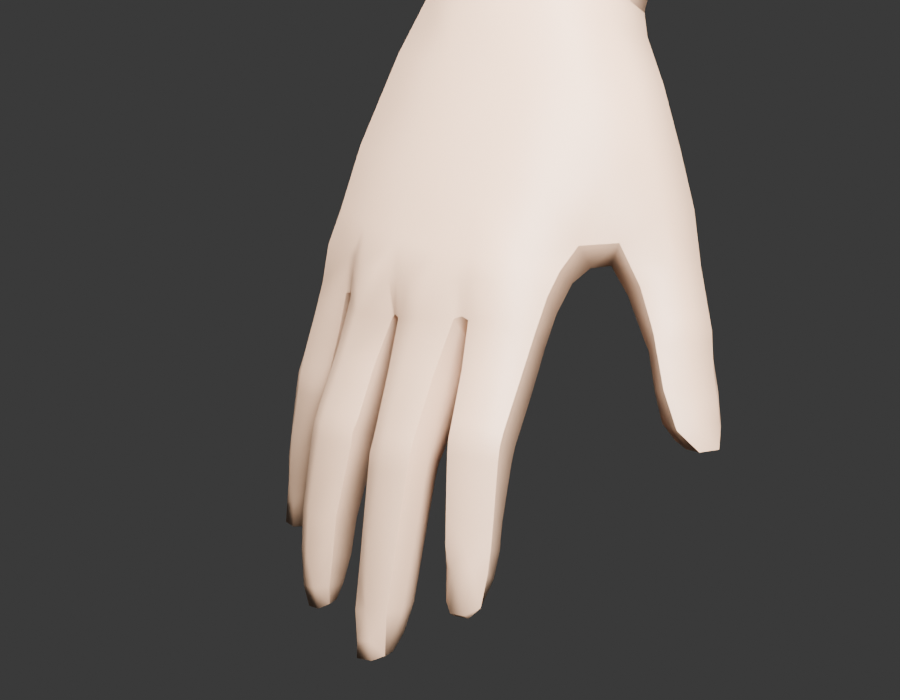
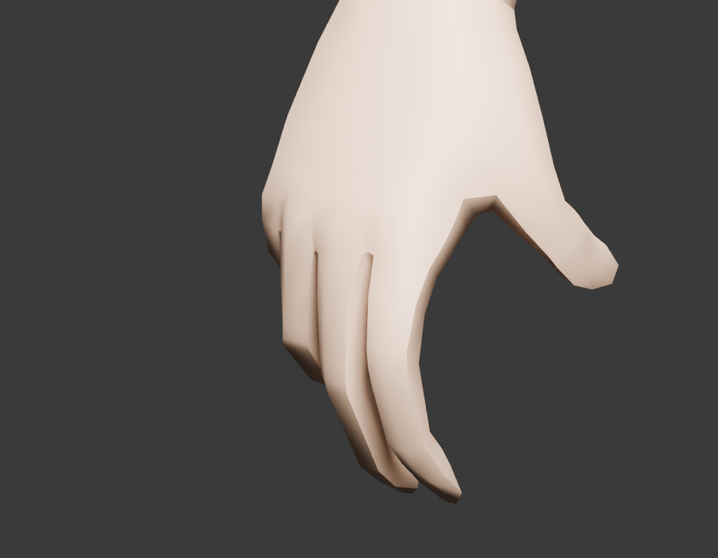
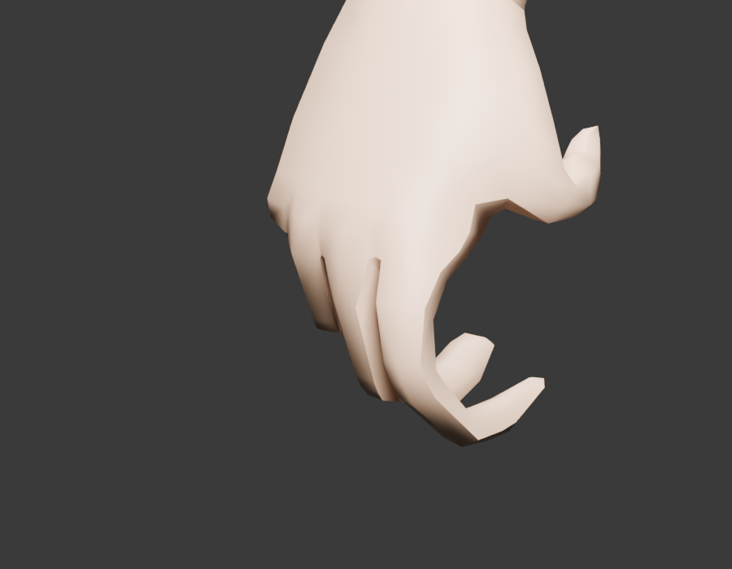

# 手指骨骼制作与验收

日期：2026-10-11。适用：WuduRaceTest v0.2.7，本机 Native v1.4.8。

## 实现范围

以 v0.2.6 为基线，双手继续使用完整身体中的 `wdr_part_04`，四级 LOD 均保留。源模型所有顶点及原有 28 骨的绑定世界矩阵保持不变；新增骨骼索引 28–57，左右五指各三个关节，总数 58，低于本机 `Skeleton.MaxBoneCount=64`。

骨名为 `l/r_thumb/index/middle/ring/little_1/2/3`。拇指按根部、中间和末节设置，其余手指按指根、第二和第三关节设置；根部挂在原有左右 `hand` 下。源文件名称末尾另带引擎索引，便于导出权重。`tools/finger_rig.py` 集中保存当前模型的关节位置、平滑权重和离线旋转方法。仅双手使用新增关节，其余部件权重仍在原有 28 骨中。

`FingerController` 在单人任务场景的 `OnPreDisplayMissionTick` 回调中，只对 `wdr_canglan` 的活动角色应用。核对骨架名称、58 骨数量和每个新增骨名后，通过本机 `SetBoneLocalFrame` 写入局部旋转，随后更新骨架世界矩阵。每次从绑定局部矩阵出发，不累计旋转。右手主武器、左手副武器分别控制握持；弓和不能单手使用的武器使左手加入支撑。握持目标以时间插值过渡，收起武器后返回源姿态。异常时停用该角色的驱动并记录日志，不修改其他种族。

这是一组通用握持角度，尚未按武器柄径、弓弦或攻击阶段分别校准。背包、百科、编辑页不属于任务场景，尚未接入该手指驱动；此前两页的背手问题继续保留为未解决事项。

## 可编辑源文件

`source/WuduCanglan_Rigged.blend` 和 `.fbx` 都含 58 骨与双手蒙皮。Blend 帧 1 为张手，帧 30 为握紧，帧 60 返回张手，可直接播放或选择手指骨在局部 X 轴旋转。FBX 保存骨架、权重及形变，当前导出没有烘焙此示例动作。26 个旧实验形变保留且默认值为零，不用于本版游戏驱动。

## 离线证据与限制

- [手指检查](finger_validation.json)：最终 TPAC 的骨架和四级权重回读，30 个关节逐个变形、左右独立握持、半握和全握，以及原生站立、跑步全周期、挥刀、持弓、骑乘和预览姿态抽样。
- [资源检查](release_validation.json)：最终包哈希、原始形状、骨索引、量化权重、XML/动作集及未涉及兵种的合并结果。
- [可编辑源文件检查](editable_source_validation.json)：Blend/FBX 重开、58 骨、原顶点、打包贴图、实验形变及 Blend 握指动画实际变形。
- [关节位置](finger_rig_layout.json)：本版新增关节的父级和首尾位置。

以上为离线结构和蒙皮检查，不证明原生动作与新增骨架的引擎映射、显示前更新顺序及武器接触效果已经通过游戏验收。助手没有启动游戏。

## 近景与游戏验收

游戏中先确认左右手可见，再拔剑／收剑观察右手变化、持盾检查左手，最后检查弓、双手武器和骑乘。核对 `probe_v0.2.7.log` 的 `FINGER_READY`、`FINGER_GRIP`，有异常时查看 `FINGER_REJECT`、`FINGER_ERROR`；日志仅证明驱动运行路径，屏幕显示和接触位置仍由用户确认。

官方参考：[动画说明](https://moddocs.bannerlord.com/asset-management/asset-types/animations/)规定最多 64 骨，原版左右手姿态属性使用形变；[Skeleton API](https://apidoc.bannerlord.com/v/1.3.4/class_tale_worlds_1_1_engine_1_1_skeleton.html)列出局部骨矩阵控制接口。本次接口存在性及调用签名另以本机 v1.4.8 DLL 核对，编译通过不等于游戏验收。
